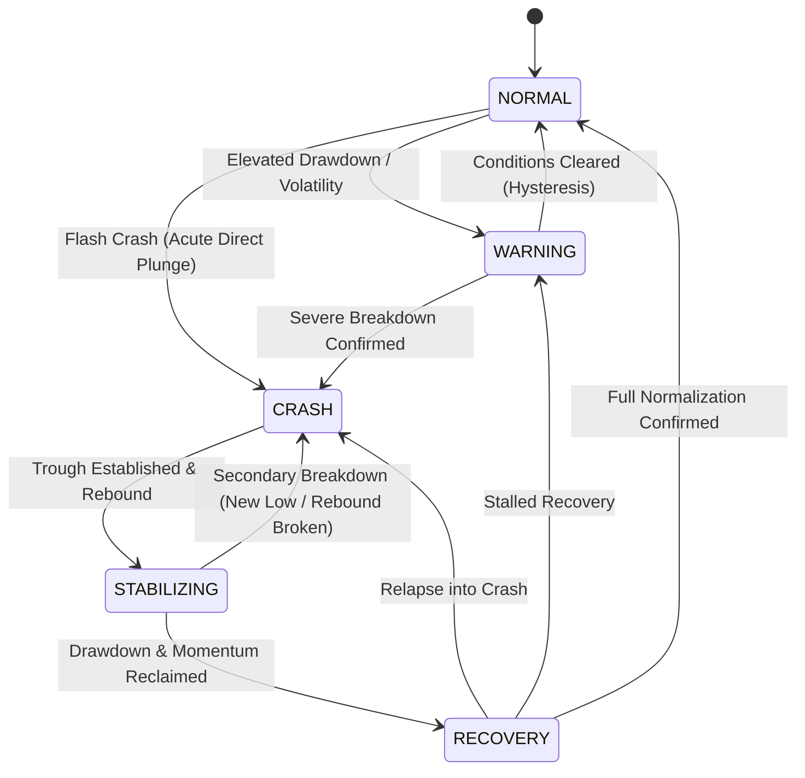

# Market Status Monitor

## 1. Overview

The **Market Status Monitor** is a shared, deterministic risk subsystem that classifies broad market conditions and outputs actionable trading authorization recommendations. It operates completely independently of individual strategy implementations and does not modify BUY, SELL, SHORT, or COVER strategy logic.

The monitor continuously tracks broad-market benchmark ETFs (`SPY`, `QQQ`, `IWM`) using standard completed bar data (`Candle` objects from existing data adapters), computes point-in-time risk metrics with strict `Decimal` precision, and governs a state machine with explicit hysteresis to protect trading capital during market stress.

---

## 2. Core Market States

The monitor classifies market health into five discrete, sequential states:

| State | Classification | Description | Default Trading Action |
|---|---|---|---|
| **`NORMAL`** | Healthy Market | Risk metrics within standard ranges. Broad participation and trend continuity. | All trades authorized (BUY & SHORT allowed). |
| **`WARNING`** | Elevated Risk | Material drawdown or elevated volatility with negative momentum. Breadth deteriorating. | New BUY restricted. SHORT allowed. Exits preserved. |
| **`CRASH`** | Acute Downside Shock | Severe drawdown or acute downward expansion across broad indices. | New BUY blocked. SHORT allowed. Exits preserved. |
| **`STABILIZING`** | Base Formation | Post-crash stabilization. No new lows established; volatility beginning to contract. | New BUY blocked. New SHORT restricted. Exits preserved. |
| **`RECOVERY`** | Trend Reclaim | Meaningful rebound off trough, positive momentum, and broad participation re-emerging. | Qualified BUY allowed. New SHORT restricted. Exits preserved. |

---

## 3. State Transition Model

### 3.1 State Diagram



### 3.2 Transition Rules and Shortcuts

Transitions proceed progressively through normal cycles:
- **`NORMAL` $\rightarrow$ `WARNING` $\rightarrow$ `CRASH`**
- **`CRASH` $\rightarrow$ `STABILIZING` $\rightarrow$ `RECOVERY` $\rightarrow$ `NORMAL`**

Direct shortcuts are permitted when conditions materially deteriorate or resolve:
- **`NORMAL` $\rightarrow$ `CRASH`**: Acute Flash Crash (e.g., benchmark drop $\le -5.0\%$ or composite $\le -3.5\%$ with broad consensus).
- **`WARNING` $\rightarrow$ `NORMAL`**: Rapid false alarm recovery with clean hysteresis confirmation.
- **`STABILIZING` $\rightarrow$ `CRASH`**: Secondary breakdown (new lower low or stabilization rebound broken).
- **`RECOVERY` $\rightarrow$ `CRASH`**: Immediate relapse if drawdown collapses back below crash threshold.

---

## 4. Deterministic Risk Metrics

All calculations use strict `Decimal` arithmetic with no floating-point rounding ambiguities:

### 4.1 Broad-Market Drawdown
For each reference symbol $s \in \{\text{SPY}, \text{QQQ}, \text{IWM}\}$ over peak lookback window (default 390 completed 1-minute bars):
$$\text{Drawdown}_s = \frac{\text{Close}_{\text{latest}} - \max(\text{High}_{\text{lookback}})}{\max(\text{High}_{\text{lookback}})} \times 100$$
$$\text{Composite Drawdown} = \frac{1}{N}\sum_{s=1}^N \text{Drawdown}_s, \quad \text{Worst Drawdown} = \min_{s} (\text{Drawdown}_s)$$

### 4.2 Realized Volatility
Sample standard deviation of per-bar close-to-close percentage returns over a rolling window (default 20 bars), scaled to basis points ($1 \text{ bps} = 0.01\%$):
$$\sigma_s = \sqrt{\frac{1}{M - 1} \sum_{i=1}^M (r_i - \bar{r})^2} \times 10{,}000$$
$$\text{Realized Volatility} = \frac{1}{N} \sum_{s=1}^N \sigma_s$$

### 4.3 Momentum
Distance of latest close from the simple moving average (SMA, default 20 bars) in basis points:
$$\text{Mom}_s = \frac{\text{Close}_{\text{latest}} - \text{SMA}_s}{\text{SMA}_s} \times 10{,}000$$
$$\text{Composite Momentum} = \frac{1}{N} \sum_{s=1}^N \text{Mom}_s$$

### 4.4 Breadth Weakness Ratio
Fraction of reference symbols currently under stress ($\text{Drawdown}_s \le -1.5\%$ or $\text{Mom}_s < 0$):
$$\text{Breadth Weakness} = \frac{\text{Count}(\text{Weak Symbols})}{N}$$

### 4.5 Trough Drawdown and Rebound
During stress episodes (`CRASH`, `STABILIZING`, `RECOVERY`):
- $\text{Trough Drawdown} = \min(\text{Prior Trough}, \text{Current Composite Drawdown})$
- $\text{Bars Since Trough}$: Bar count since the trough drawdown was last established.
- $\text{Rebound} = \text{Current Composite Drawdown} - \text{Trough Drawdown}$

---

## 5. Hysteresis and Anti-Oscillation

To prevent flip-flopping around threshold boundaries, state transitions enforce multi-bar confirmation:

| Transition | Confirmation Rule |
|---|---|
| `NORMAL` $\rightarrow$ `WARNING` | 2 consecutive bars meeting warning conditions |
| `WARNING` $\rightarrow$ `CRASH` | 2 consecutive bars (or 1 bar for acute flash crash) |
| `WARNING` $\rightarrow$ `NORMAL` | 3 consecutive bars with drawdown $> -0.8\%$ (hysteresis gap above $-1.5\%$) |
| `CRASH` $\rightarrow$ `STABILIZING` | Minimum 5 bars in crash, $\ge 5$ bars without new lows, and rebound $\ge +0.5\%$ held for 3 bars |
| `STABILIZING` $\rightarrow$ `RECOVERY` | Minimum 5 bars in stabilizing, composite drawdown $\ge -1.2\%$, positive momentum, held for 3 bars |
| `RECOVERY` $\rightarrow$ `NORMAL` | Drawdown $\ge -0.5\%$, realized volatility $< 25$ bps, positive momentum, held for 3 bars |
| Relapse to `CRASH` | Immediate (1 bar) upon breakdown breach or severe collapse |

---

## 6. Resilience and Fail-Closed Guarantees

### 6.1 Missing Data and Staleness
- If fewer than `min_required_symbols` (default 2 of 3) have data, or if the latest candle end timestamp exceeds `max_observation_age_seconds` (default 300s):
  - The monitor flags `data_available=False` or `is_stale=True`.
  - Trading authorization **fails closed**: new entry signals (`BUY` and `SHORT`) are blocked.
  - Reason codes record the failure (`MARKET_DATA_UNAVAILABLE`, `MARKET_DATA_STALE`).

### 6.2 The Core Invariant
> **CRITICAL ARCHITECTURAL INVARIANT**:
> The Market Status Monitor **NEVER** blocks protective stops, `SELL` exits, `COVER` exits, or emergency risk liquidations in any state under any circumstance.
>
> Even during `CRASH`, missing data, or stale feeds:
> - `sell_allowed` is `True`
> - `cover_allowed` is `True`
> - `protective_stops_allowed` is `True`
> - `emergency_liquidation_allowed` is `True`

This invariant is unconditionally verified by automated unit tests and enforced by runtime assertions in `TradingAuthorizationDecision`.

---

## 7. Evaluation Cadence, Persistence and Historical Replay

### 7.1 Evaluation cadence (call-frequency independent)
`evaluate()` is a pure read except that it advances the state machine **at most once per
completed reference minute**. A minute `E` is complete when every configured reference symbol has
a bar ending at or after `E` (or, after a 60 s grace period, when `min_required_symbols` do).
Repeated calls (entry gates, heartbeats, the backtest loop) therefore never change the hysteresis
counters: the state sequence depends only on the data fed in, which is what makes SHADOW and
BACKTEST equivalent. Without an explicit `as_of`, the injected clock supplies the evaluation time
so a stalled feed is detected as stale; with no clock the latest bar defines "now".

### 7.2 Restart persistence
- `SqliteMarketStatusRepository` (production) stores the snapshot in the existing
  `service_health` table (component `market_status_monitor`); it is written on every runtime
  heartbeat and at shutdown and restored at startup. `InMemoryMarketStatusRepository` and
  `JsonFileMarketStatusRepository` exist for tests and tools.
- The snapshot includes state, hysteresis counters, episode trackers, the last advanced minute and
  the recent reference candles, so a restart during `CRASH` resumes in `CRASH`.
- An **absent** document is a fresh start. An **unreadable** document (or any restore error) makes
  the monitor *fail closed*: new BUY and SHORT entries are blocked (`MARKET_STATUS_RESTORE_FAILED`)
  until a full lookback (`peak_lookback_bars`) of reference minutes has been observed again.
  Exits and stops are never affected.

### 7.3 Historical replay compatibility
`MarketStatusMonitor` has no hidden wall-clock dependencies when fed bar data. The backtest runner
feeds reference candles strictly by availability time (ahead of any trading event at the same or a
later time), steps the monitor once per distinct reference minute and never reads live market data.

---

## 8. Integration with the Bidirectional Engine

`execution.market_status_enabled: true` (default `false`) enables the monitor in SHADOW. Reference
symbols (`SPY`, `QQQ`, `IWM`) are fetched independently of the trading symbols (de-duplicated when
also traded), fed to the monitor and never evaluated by trading strategies.

```
 reference candles --> MarketStatusMonitor --> TradingAuthorizationDecision
                                                  |  buy_allowed / short_allowed
                                                  v
 BUY, SHORT candidates --(drop unauthorized direction)--> arbitration --> existing gates
                                                              (cutoff, budget, margin, caps)
 SELL, COVER, protective stops, liquidation -----------------------------> never gated
```

- Authorization is **per direction and additional**: the runtime gate, entry cutoff, budget, margin,
  short-selling authorization, exposure and protection requirements are unchanged and still apply.
- Candidates of a restricted direction are dropped **before** arbitration, so a restricted BUY can
  never suppress an authorized SHORT (nor the reverse). SHORT is *not* authorized by `CRASH`: a
  strategy must still produce a valid SHORT signal and pass every other restriction.
- `MarketStatusEntryGate.authorized` means "some entry direction is open";
  `MarketStatusEntryGate.authorizes(direction)` is the per-direction query used by the SHADOW
  lifecycle; `PortfolioManager` passes `action="ENTER_SHORT"` to `evaluate_entry` for shorts.
- BACKTEST (`config["market_status_enabled"]`): refused candidates are recorded as `ENTRY_REFUSED`
  decisions with `gate: MARKET_STATUS` and the market state; they affect real order decisions.
- Default policy (`TradingAuthorizationPolicy`): NORMAL BUY+SHORT; WARNING SHORT only; CRASH SHORT
  only; STABILIZING neither; RECOVERY BUY only. Missing or stale reference data blocks both.

### 8.1 Limitations
- SHADOW and BACKTEST are the supported autonomous strategy-evaluation environments. PAPER/LIVE
  runtimes are built with `lifecycle=None` (no automatic strategy evaluation), so the monitor does
  not gate automated PAPER/LIVE entries; LIVE short trading remains disabled by configuration.
- The backtest monitor starts empty at the window start (reference candles before the window are
  not replayed), so entries are blocked until two reference symbols have data. Research
  (`research-batch`) does not yet expose the market-status switch.

---

## 9. Portfolio Integration Guide

### 8.1 Integration Architecture
The monitor connects into the portfolio layer via the `MarketStatusEntryGate` adapter:

```
                  ┌─────────────────────────┐
                  │ MarketStatusMonitor     │
                  └────────────┬────────────┘
                               │ snapshot()
                               ▼
                  ┌─────────────────────────┐
                  │ MarketStatusEntryGate   │  (implements EntryGate protocol)
                  └────────────┬────────────┘
                               │ evaluate(EntryRequest)
                               ▼
┌───────────────────────────────────────────────────────────┐
│ Portfolio Manager (order intake & capacity reservation)   │
│                                                           │
│  - BUY entry?   -> Checked against EntryGate              │
│  - SHORT entry? -> Checked against EntryGate              │
│  - SELL exit?   -> Unconditionally allowed                │
│  - Risk stop?   -> Unconditionally allowed                │
└───────────────────────────────────────────────────────────┘
```

### 8.2 Code Example

```python
from mike_trade.market_status import MarketStatusMonitor, MarketStatusEntryGate
from mike_trade.market_status.persistence import JsonFileMarketStatusRepository

# 1. Initialize monitor with persistent repository
repo = JsonFileMarketStatusRepository("/path/to/market_status.json")
monitor = MarketStatusMonitor()
saved_state = repo.load("shadow:default")
if saved_state:
    monitor.restore(saved_state)

# 2. Wire into portfolio entry gating
gate = MarketStatusEntryGate(monitor)

# 3. Feed bar updates from market-data engine
for bar in incoming_bars:
    monitor.add_bar(bar)
snapshot = monitor.evaluate()

# 4. Save state on cycle completion
repo.save("shadow:default", monitor.snapshot())
```
